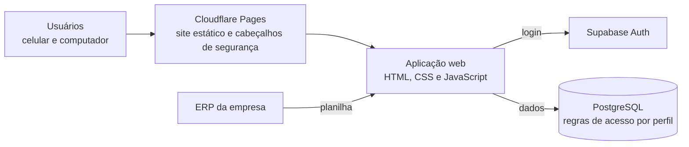

# 🏭 Biotec Gestão

**Sistema web de gestão de fábrica, em uso na Biotec Hospitalar no celular e no computador.**

> Este repositório é uma vitrine do projeto. O código-fonte é privado, por pertencer à empresa.

---

## 📌 Sobre o projeto

O Biotec Gestão reúne em um só lugar a rotina da fábrica: da produção no chão de fábrica até o painel da diretoria. Projetei e desenvolvi o sistema inteiro, unindo programação com o que conheço de PCP (planejamento e controle da produção).

## 🧩 Módulos

| Módulo | O que faz |
| --- | --- |
| 📊 Painel da diretoria | Visão consolidada da fábrica para a direção, incluindo vendas |
| ⚙️ Máquinas e produção | Lançamento da produção por máquina |
| 📦 Estoques | Controle dos estoques |
| 💰 Custos e preço de venda | Cálculo de custos, formação do preço de venda e cotações |
| 🗓️ PPCP | Sugestão de planejamento e programação da produção |
| 🛒 Vendas | Acompanhamento das vendas |
| 🚚 Entregas | Painel de entregas, com links para o mapa e para contato por WhatsApp |
| 📱 App do motorista | Aplicativo instalável (PWA) para o motorista, com abertura do endereço no Google Maps |
| 🗂️ Cadastros e importação | Cadastros gerais e importação de dados do ERP por planilha |
| 👥 Usuários e acessos | Liberação de usuários e definição do perfil de cada pessoa |

## 🏗️ Arquitetura

- **Sem etapa de build:** o site é estático e publicado como está, o que deixa a manutenção simples.
- **Banco de dados e login no Supabase:** PostgreSQL com autenticação integrada.
- **Aplicativo instalável:** o módulo do motorista funciona como PWA, direto na tela inicial do celular.

## 🔐 Segurança

- **Acesso por perfil no banco de dados (RLS):** sem login liberado, nada é lido nem gravado.
- **Sete perfis de acesso:** Diretoria, Comercial, PCP, Encarregado, Operador, Almoxarifado e Custos.
- **Liberação manual:** cada pessoa cria o acesso com o e-mail da empresa e fica aguardando um administrador liberar.
- **Proteções do navegador:** política de segurança de conteúdo (CSP) restritiva, bloqueio de iframe e HTTPS obrigatório.

## 👨‍💻 Meu papel

Projeto e desenvolvimento completos: modelagem do banco de dados, regras de acesso, telas, aplicativo do motorista e publicação.

## 📫 Contato

